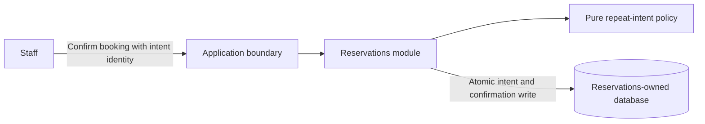

# Worked handoff excerpt: repeat-intent decision

This is a fictional example of task specificity for HarborDesk, not a universal scaffold or code to run during planning. Assume the agreed design uses a Python modular server, pytest already exists, and confirmation intents must distinguish a repeated request from a different payload using the same identity. The plan author has inspected those stack facts in the hypothetical project. None of the commands below have been executed by this skill.

## System map and target before the task excerpt

HarborDesk is a fictional booking server: members request slots and staff confirm them. Reservations owns confirmation state and intent results; the authoritative database owns exclusivity constraints. The target remains a modular monolith because no independent deployment need is established. A cache/broker would not enforce slot exclusivity and is not selected. The following is a proposed target, not evidence of an inspected implementation; Mermaid rendering has not been verified.



The pure policy decides replay/create/conflict; the write boundary enforces concurrency. These are components of one server, not separate services. This overview and its constraints must be presented with the detailed plan, not replaced by a file link.

| Need | Target decision / contract | Owning work / acceptance |
| --- | --- | --- |
| Same request returns original result | `decide_confirmation` and stored intent identity | Task 1 below: concrete replay/conflict assertions |
| Only one confirmed holder per slot | Atomic authoritative transaction plus database constraint | Required later persistence task: concurrent competing confirmations and duplicate-intent integration checks |
| Existing deployment remains usable | Single modular server; no new network dependency | Complete plan: compatibility and deployment-input checks owned by the migration task if changes are needed |

The excerpt below details Task 1 only. A real full plan must specify the remaining tasks at the same level, including their exact files/contracts; this table is not a substitute. It illustrates the connection from system intent to implementation, not a reusable prescribed stack.

## Goal, architecture and global constraints

Goal: define the pure domain decision for a repeated confirmation intent. Persistence and slot exclusivity remain the responsibility of the authoritative write transaction, planned separately. A pure decision function does not by itself make concurrent requests idempotent.

Constraints: IDs are nonempty strings validated at the application boundary; an existing intent with identical booking and slot returns its original confirmation ID; reusing its intent ID for a different payload raises `IntentConflict`; a new intent requests creation. No network, cache or broker is needed for this task.

## Task 1 — Classify repeat intent without side effects

**Result:** callers receive an unambiguous `create` or `replay` decision and a conflict for mismatched payload reuse.

**Files:**

- Create: `backend/harbor_desk/reservations/confirmation_decision.py` — pure decision and its local value types.
- Modify: none.
- Test: Create `backend/tests/unit/test_confirmation_decision.py` — repeat/new/conflict behavior.

**Interfaces produced**, all defined in the created module:

```python
@dataclass(frozen=True)
class ExistingConfirmation:
    intent_id: str
    booking_id: str
    slot_id: str
    confirmation_id: str

@dataclass(frozen=True)
class ConfirmationDecision:
    action: Literal["create", "replay"]
    confirmation_id: str | None

class IntentConflict(ValueError): ...

def decide_confirmation(
    existing: ExistingConfirmation | None,
    intent_id: str, booking_id: str, slot_id: str,
) -> ConfirmationDecision: ...
```

Use standard-library dataclasses and typing. `existing` is either absent or the record retrieved **for this intent_id**; the application/persistence caller owns that lookup contract. No other task-provided test fixture is required.

- [ ] **Write `test_same_intent_replays_original_confirmation` in the test file.** Import the named interfaces from the created module. The behavioral core is:

```python
existing = ExistingConfirmation("intent-7", "booking-3", "slot-9", "confirmation-2")
result = decide_confirmation(existing, "intent-7", "booking-3", "slot-9")
assert result.action == "replay"
assert result.confirmation_id == "confirmation-2"
```

- [ ] **Run the focused check from `backend/`:** `python -m pytest tests/unit/test_confirmation_decision.py::test_same_intent_replays_original_confirmation -q`. Expected before implementation: failure because the new module/function does not yet exist. Confirm the error concerns this missing behavior, not missing pytest or a broken source path.
- [ ] **Implement the declared types and `decide_confirmation` in the exact file.** For no existing record return `create` with no confirmation ID. For an existing same-intent record compare booking/slot; on a match return `replay` with its original confirmation ID; on a mismatch raise `IntentConflict`. Do not add persistence or an external call to this pure policy.
- [ ] **Add `test_new_intent_requests_creation`**, asserting the new-intent behavior:

```python
result = decide_confirmation(None, "intent-8", "booking-4", "slot-9")
assert result.action == "create"
assert result.confirmation_id is None
```

- [ ] **Add `test_same_intent_with_different_payload_is_conflict`**, importing pytest and using its parameterization for `(booking-4, slot-9)` and `(booking-3, slot-10)`. Its behavioral assertion is:

```python
existing = ExistingConfirmation("intent-7", "booking-3", "slot-9", "confirmation-2")
with pytest.raises(IntentConflict):
    decide_confirmation(existing, "intent-7", booking_id, slot_id)
```

Here `booking_id` and `slot_id` are the explicitly parameterized pair, not an unstated fixture.
- [ ] **Run focused and regression checks from `backend/`:** `python -m pytest tests/unit/test_confirmation_decision.py -q`, then `python -m pytest tests/unit -q`. Expected: all new policy cases and existing unit regressions pass. Refactor local repetition only if useful, then repeat these checks.

**Repeat/transaction semantics:** this task is pure and performs no write, so it owns no transaction. It defines semantic classification only. The next persistence/application task must read/claim the intent and apply the confirmation atomically, enforce unique active slot ownership, and return the original result after an ambiguous commit/retry. Its integration tests must race distinct bookings for one slot and concurrent copies of one intent. A caller must not treat a stale `create` decision as permission for an unguarded write.

**Dependencies/conflicts:** a later write task consumes the above types and signature; it must not redefine them under different names. If it modifies this module, order those edits after this task rather than mark the two tasks independently editable.

**Acceptance:** all named decisions/errors match the agreed repeat semantics; no application state changes here; the handoff explicitly reserves atomicity/concurrency guarantees for the authoritative persistence task. The complete project plan must include that task, not stop at this illustrative excerpt.

## What this demonstrates

The plan supplies exact files, interfaces, values, tests, commands and expected observations. It supplies a small value-type/behavior excerpt where it settles an interface, while leaving routine implementation to the executor. It distinguishes a domain policy from a transaction guarantee. Apply the same specificity to the real project's inspected stack and requirements; do not copy the fictional paths or IDs as a mandatory design.
